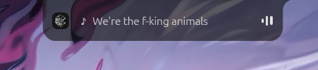
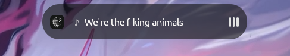
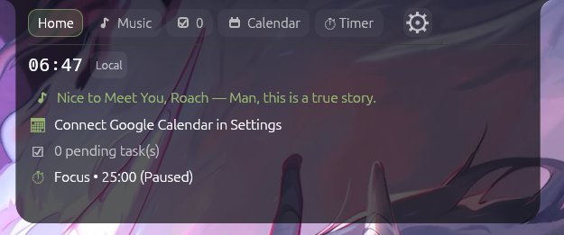
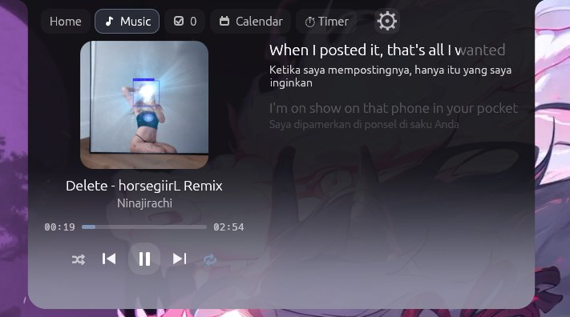
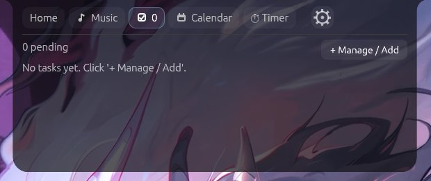
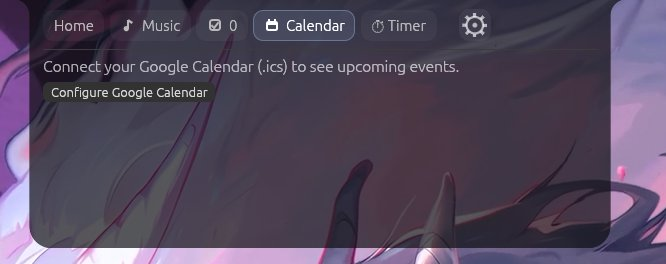
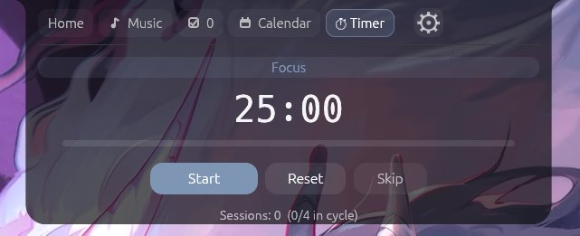
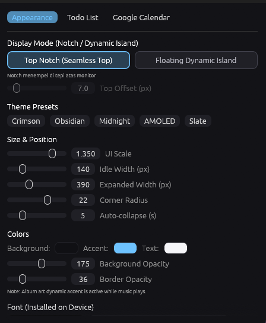

# Liebert Dynamic Island (Lidi)
> Lightweight native Rust Dynamic Island overlay for **Windows 10/11** and **Linux (X11/Wayland)** that surfaces system notifications, media controls, synced karaoke lyrics, a Pomodoro timer, a local todo list, and Google Calendar alerts at the top-center of your screen without stealing window focus.

## UI

## Table of Contents

- [Liebert Dynamic Island (Lidi)](#liebert-dynamic-island-lidi)
  - [Table of Contents](#table-of-contents)
  - [UI](#ui)
    - [Idle Modes (Top Notch \& Floating Dynamic Island)](#idle-modes-top-notch--floating-dynamic-island)
    - [Expanded Hub Tabs](#expanded-hub-tabs)
  - [Settings](#settings)
  - [Key Features](#key-features)
  - [Tech Stack](#tech-stack)
  - [Prerequisites](#prerequisites)
  - [Getting Started](#getting-started)
    - [1. Clone the Repository](#1-clone-the-repository)
    - [2. Verify OS Notification Access (Optional Spike)](#2-verify-os-notification-access-optional-spike)
    - [3. Run in Demo Mode or Normal Mode](#3-run-in-demo-mode-or-normal-mode)
    - [4. Build Optimized Release Binary](#4-build-optimized-release-binary)
  - [Architecture](#architecture)
    - [Directory Structure](#directory-structure)
    - [Data Flow \& State Machine](#data-flow--state-machine)
    - [Local Persistence Paths](#local-persistence-paths)
  - [Configuration](#configuration)
  - [Available Commands](#available-commands)
  - [Testing](#testing)
  - [Packaging \& Distribution](#packaging--distribution)
  - [Troubleshooting](#troubleshooting)

---

## UI

### Idle Modes (Top Notch & Floating Dynamic Island)

|                                 Top Notch                                 |                             Floating Dynamic Island                              |
| :-----------------------------------------------------------------------: | :------------------------------------------------------------------------------: |
|  |  |
|  |  |

### Expanded Hub Tabs

|                          Home Overview                           |                       Music & Synced Karaoke Lyrics                       |
| :--------------------------------------------------------------: | :-----------------------------------------------------------------------: |
|  |  |

|                          Todo List                          |                           Google Calendar                           |                        Pomodoro Timer                         |
| :---------------------------------------------------------: | :-----------------------------------------------------------------: | :-----------------------------------------------------------: |
|  |  |  |

> Switch between **Top Notch** and **Floating Island** modes, with live synced karaoke lyrics, notifications, media controls, Todo list, Google Calendar, and Pomodoro Timer.

---

## Settings

<p align="center">
  
</p>

---

## Key Features

- **Non-Intrusive Notification Overlay:** Smooth `Idle` ↔ `Compact` ↔ `Expanded` pill transitions with branded app accents (WhatsApp, Discord, Gmail, Chrome, Telegram, Slack, etc.), notification queueing with ID deduplication, hover-to-expand, and configurable auto-collapse.
- **Top Notch & Floating Island Modes:** Switch in Settings between a seamless bezel-docked **Top Notch** (with concave ears) and a **Floating Dynamic Island**, rendered on a permanent click-through transparent canvas (`WS_EX_LAYERED | WS_EX_TRANSPARENT`) to prevent open/close flicker, with smooth slide + fade auto-hide transitions.
- **Smart Fullscreen & Auto-Hide:** Automatically hides when an exclusive/borderless fullscreen app or game is active, with an optional toggle (`hide_in_windowed_fullscreen`) for maximized / windowed-fullscreen apps, while still surfacing incoming notifications and obeying `auto_hide_delay_secs` upon exit without dropping the Settings window.
- **Media Controls & 60 FPS Karaoke Lyrics:** Read playback state and control Shuffle, Previous, Play/Pause, Next, Repeat, and seek position via Windows SMTC or Linux MPRIS2. Fetches synced `.lrc` / enhanced word-level lyrics from LRCLIB with smooth 60 FPS progressive karaoke highlight in **Original**, offline **Romaji** (`kakasi` + `any_ascii`), or **Translate** mode, plus dynamic accent extraction from album art (`Arc<AlbumArt>`).
- **Built-In Productivity Suite:** Includes a **Pomodoro Timer** (`Focus` / `Short Break` / `Long Break` with 4-session cycles, idle countdown, and completion alerts), local **Todo List** (`todos.toml`), **Google Calendar** `.ics` sync (with `RRULE` recurring event expansion, `EXDATE`/`TZID` support, current-week filtering, 120s auto-refresh, and 5-minute upcoming alerts), and an IANA timezone **Clock**.
- **Device Font Picker & Live Settings:** Deferred secondary Settings viewport (`Appearance`, `Todo List`, `Google Calendar`) with full OS clipboard copy/paste support, 5 theme presets (`Crimson`, `Obsidian`, `Midnight`, `AMOLED`, `Slate`), custom RGB/opacity, scale, dimensions, installed device font selector, and system tray controls.

---

## Tech Stack

- **Language:** Rust (`edition = "2024"`)
- **GUI & Rendering:** `eframe 0.37` (`egui`, `Renderer::Glow` with `x11` & `wayland` support)
- **System Tray:** `tray-icon 0.27` (`ksni` D-Bus StatusNotifierItem on Linux)
- **Windows Platform Bridge (`windows 0.62`):**
  - Win32 overlay hooks (`WS_EX_NOACTIVATE`, `WS_EX_TOOLWINDOW`, `WS_EX_TRANSPARENT | WS_EX_LAYERED`, `WM_NCCALCSIZE` subclass)
  - DWM integration (`DWMWA_WINDOW_CORNER_PREFERENCE`, `DWMWA_BORDER_COLOR`, `DWMWA_EXTENDED_FRAME_BOUNDS`)
  - WinRT `UserNotificationListener` (with `500 ms` fallback polling for unpackaged `.exe`), SMTC (`Media_Control`), `Storage_Streams` album art
  - Fullscreen detection via `SHQueryUserNotificationState`, `IsZoomed`, and `GetMonitorInfoW`
- **Linux Platform Bridge (`zbus 6.5`):** D-Bus `org.freedesktop.Notifications` listener, MPRIS2 (`org.mpris.MediaPlayer2.*`), and Hyprland UNIX socket IPC
- **Data, Network & Text:** `serde`, `serde_json`, `toml 1.2`, `directories 6.0`, `ureq 3.5` (LRCLIB, Google Translate, Google Calendar `.ics`), `image 0.25` (PNG/JPEG/WebP), `kakasi 0.1` + `any_ascii 0.3`, `chrono 0.4` + `chrono-tz 0.10`

---

## Prerequisites

- **Rust Toolchain:** Rust with `edition = "2024"` support (`rustc 1.85+` or newer, e.g. via `rustup`).
- **Windows 10 / 11:**
  - Runs directly as an unpackaged `.exe` (no Administrator privileges required).
  - Ensure **Settings → System → Notifications** is enabled so `UserNotificationListener` receives desktop toasts.
- **Linux (X11 / Wayland):**
  - `org.freedesktop.Notifications` permits only **one** active notification daemon per desktop session; stop any existing daemon (such as `dunst` or `mako`) before testing notifications.
  - On Wayland compositors without `wlr-layer-shell` support in `winit`, Hyprland IPC rules are used when available.

---

## Getting Started

### 1. Clone the Repository

### Prebuilt releases

Every `v*` GitHub Release contains:

| Asset | Install |
| :--- | :--- |
| `Liebert_Dynamic_Island-0.1.11-x86_64.AppImage` | `chmod +x` then run it (needs FUSE, or use `--appimage-extract`). |
| `liebert-dynamic-island-linux-x86_64.tar.gz` | `tar -xzf`, then run `./liebert-dynamic-island-linux-x86_64/liebert-dynamic-island`. Includes `LICENSE.md`, `README.md`, `.desktop` and icon. |
| `liebert-dynamic-island-windows-x86_64-setup.exe` | NSIS installer (per-user install, Start Menu shortcuts + uninstaller). |
| `liebert-dynamic-island-windows-x86_64.zip` | Portable `.exe` + license + README. |
| `liebert-dynamic-island-aur-0.1.11.tar.gz` | AUR `PKGBUILD` + `.SRCINFO` for Arch Linux. |

Arch Linux users can build from `packaging/aur/` with `makepkg -si` once the package is submitted to the AUR (`yay -S liebert-dynamic-island`). AUR submission itself needs a maintainer account and is **not** automated by CI.

### Build from source

```sh
git clone https://github.com/Gjenius20/liebert-dynamic-island.git
cd liebert-dynamic-island
cargo build --release --locked
```

### 2. Verify OS Notification Access (Optional Spike)

```sh
cargo run -- --spike-notifications
```

Expected output on Windows:
| Key | Type | Default | Description |
| :--- | :--- | :--- | :--- |
| `notch_dock_mode` | `bool` | `true` | `true` for seamless Top Notch, `false` for Floating Dynamic Island |
| `scale` | `f32` | `1.0` | UI scale factor (`0.75`–`1.5`) |
| `idle_width` / `expanded_width` | `f32` | `140.0` / `390.0` | Pill width in idle (`110`–`240`) and expanded (`320`–`520`) states |
| `top_offset_px` | `f32` | `10.0` | Top margin in Floating Island mode (`0`–`60`) |
| `auto_hide_when_idle` | `bool` | `false` | Automatically hide the overlay after `auto_hide_delay_secs` |
| `auto_hide_delay_secs` | `u64` | `5` | Idle delay before auto-hiding (`0`–`60` seconds) |
| `hide_in_fullscreen` | `bool` | `true` | Hide idle pill when a fullscreen or windowed-fullscreen app is active |
| `idle_display` | `enum` | `Auto` | `Auto`, `Clock`, `Lyrics`, `NextEvent`, `Pomodoro`, `Mascot`, or `Minimal` |
| `show_idle_mascot` | `bool` | `true` | Show the cursor-tracking mascot face alongside the idle pill |
| `clock_timezone` | `string` | `"Local"` | `"Local"` or any IANA timezone (e.g. `"Asia/Jakarta"`) |
| `font_name` | `string` | `""` | Installed device font name (empty uses system default) |
| `text_align` | `enum` | `Left` | Text alignment: `Left`, `Center`, or `Right` |
| `karaoke_lyric_mode` | `enum` | `Original` | Primary karaoke text: `Original`, `Romaji`, or `Translate` |
| `lyric_offset_ms` | `i64` | `0` | Lyric sync offset in milliseconds (`-5000`–`5000`) |
| `google_calendar_ics_url` | `string` | `""` | Secret iCal `.ics` URL for Google Calendar sync |

```text
SPIKE OK: Access: Allowed | Active toasts: <count> | Sample: ...
```

### 3. Run in Demo Mode or Normal Mode

```sh
cargo run -- --demo   # Launches the overlay and triggers a sample notification after 1s
cargo run             # Launches the live overlay listening to OS notifications & media
```

### 4. Build Optimized Release Binary

```sh
cargo build --release
```

The stripped LTO binary is written to `target/release/liebert-dynamic-island.exe` (Windows) or `target/release/liebert-dynamic-island` (Linux).

---

## Architecture

### Directory Structure

```text
liebert-dynamic-island/
├── Cargo.toml
├── AGENTS.md
├── assets/                      # Shared .desktop entry & 256x256 app icon
├── docs/                        # Obsidian project notes & MVP PRD
├── installer/windows/           # NSIS installer script
├── packaging/aur/               # Arch Linux PKGBUILD + .SRCINFO
├── scripts/                     # AppImage & Linux release build scripts
└── src/
    ├── main.rs                  # Entry point, CLI flags (--demo, --spike-notifications), & worker threads
    ├── config.rs                # Local config.toml loader/saver, presets, & validation clamps
    ├── state.rs                 # OS-agnostic IslandState machine (Idle/Compact/Expanded) & queue
    ├── clock.rs                 # Digital clock & IANA timezone formatting (chrono-tz)
    ├── lyrics.rs                # LRC/Enhanced LRC parser, LRCLIB fetcher, offline romaji & translation
    ├── pomodoro.rs              # PomodoroTimer state machine (Focus/ShortBreak/LongBreak cycles)
    ├── todo.rs                  # Local TodoStore & todos.toml persistence
    ├── calendar.rs              # RFC 5545 .ics + RRULE parser & 120s Google Calendar sync worker
    ├── tray.rs                  # System tray icon & menu actions (Pause, Auto-hide, Test, Settings, Exit)
    ├── ui/
    │   ├── mod.rs               # Overlay renderer, tabs (Home/Music/Todo/Calendar/Timer), & Win32 bridge
    │   ├── icons.rs             # Shared geometric vector icons
    │   └── settings.rs          # Deferred Settings viewport & standalone Linux settings window
    └── platform/
        ├── mod.rs               # Cross-platform facade, Arc<AlbumArt> decoder & device font scanner
        ├── windows.rs           # Win32 hooks, WinRT notifications, SMTC media & fullscreen watcher
        ├── linux.rs             # D-Bus notifications, MPRIS2 media & Hyprland IPC
        └── wayland_layer.rs     # Native Wayland wlr-layer-shell overlay backend
```

### Data Flow & State Machine

```text
OS Event (WinRT / D-Bus / SMTC / MPRIS2 / Fullscreen Watcher)
   │
   ▼  (mpsc::channel + egui wake callback)
IslandApp::handle_events()
   │
   ├──► IslandState (Idle ◄──► Compact ◄──► Expanded)
   │       ├── Hover pauses collapse timer & expands pill
   │       ├── Dismiss / timeout advances notification queue
   │       └── Fullscreen hides idle pill while allowing active notifications through
   │
   └──► Renderers (CentralPanel on permanent transparent canvas + Secondary Settings Viewport)
```

### Local Persistence Paths

| File          | Windows Path                                   | Linux Path                                     | Purpose                                               |
| :------------ | :--------------------------------------------- | :--------------------------------------------- | :---------------------------------------------------- |
| `config.toml` | `%APPDATA%\liebert-dynamic-island\config.toml` | `~/.config/liebert-dynamic-island/config.toml` | Appearance, behavior, lyrics, Pomodoro & calendar URL |
| `todos.toml`  | `%APPDATA%\liebert-dynamic-island\todos.toml`  | `~/.config/liebert-dynamic-island/todos.toml`  | Local todo checklist items                            |

No notification contents are logged to disk, and no telemetry is collected.

---

## Configuration

Missing or malformed fields in `config.toml` safely fall back to `Default` and clamp numeric values to valid ranges:

| Key                                                  | Type      | Default                               | Range / Values                                                | Description                                                 |
| :--------------------------------------------------- | :-------- | :------------------------------------ | :------------------------------------------------------------ | :---------------------------------------------------------- |
| `notch_dock_mode`                                    | `bool`    | `true`                                | `true` / `false`                                              | `true` for seamless Top Notch, `false` for Floating Island  |
| `scale`                                              | `f32`     | `1.0`                                 | `0.75`–`1.5`                                                  | Global UI scale multiplier                                  |
| `idle_width`                                         | `f32`     | `140.0`                               | `110.0`–`240.0`                                               | Idle pill width in logical pixels                           |
| `expanded_width`                                     | `f32`     | `390.0`                               | `320.0`–`520.0`                                               | Expanded card width in logical pixels                       |
| `top_offset_px`                                      | `f32`     | `10.0`                                | `0.0`–`60.0`                                                  | Top screen offset in Floating Island mode                   |
| `collapse_timeout_secs`                              | `u64`     | `5`                                   | `2`–`15`                                                      | Auto-collapse timeout for active notifications              |
| `auto_hide_when_idle`                                | `bool`    | `false`                               | `true` / `false`                                              | Auto-hide overlay after `auto_hide_delay_secs` of idle time |
| `auto_hide_delay_secs`                               | `u64`     | `5`                                   | `0`–`60`                                                      | Delay before auto-hiding when idle                          |
| `hide_in_fullscreen`                                 | `bool`    | `true`                                | `true` / `false`                                              | Hide idle pill when a fullscreen app or game is active      |
| `hide_in_windowed_fullscreen`                        | `bool`    | `true`                                | `true` / `false`                                              | Also hide on windowed-fullscreen / maximized apps           |
| `idle_display`                                       | `enum`    | `Auto`                                | `Auto`, `Clock`, `Lyrics`, `NextEvent`, `Pomodoro`, `Mascot`, `Minimal` | Content displayed in idle pill                              |
| `show_idle_mascot`                                   | `bool`    | `true`                                | `true` / `false`                                              | Show cursor-tracking mascot face in idle pill               |
| `clock_timezone`                                     | `string`  | `"Local"`                             | `"Local"` or IANA TZ                                          | Timezone for clock display (e.g. `"Asia/Jakarta"`)          |
| `clock_24h` / `clock_show_seconds`                   | `bool`    | `true` / `false`                      | `true` / `false`                                              | 24-hour clock format and seconds visibility                 |
| `bg_color`                                           | `[u8; 4]` | `[16, 16, 20, 240]`                   | RGBA `0`–`255`                                                | Background color and opacity                                |
| `accent_color` / `text_color`                        | `[u8; 3]` | `[110, 195, 255]` / `[245, 245, 248]` | RGB `0`–`255`                                                 | Accent and primary text colors                              |
| `border_alpha` / `corner_radius`                     | `u8`      | `36` / `22`                           | `0`–`160` / `8`–`28`                                          | Floating pill border opacity and corner radius              |
| `font_name`                                          | `string`  | `""`                                  | Installed font name                                           | Custom device font (empty uses system default)              |
| `show_notifications`                                 | `bool`    | `true`                                | `true` / `false`                                              | Enable desktop notification popups                          |
| `show_lyrics`                                        | `bool`    | `true`                                | `true` / `false`                                              | Enable SMTC/MPRIS2 media & LRCLIB lyrics                    |
| `dynamic_album_color`                                | `bool`    | `true`                                | `true` / `false`                                              | Override accent & glow with album art dominant color        |
| `karaoke_lyrics`                                     | `bool`    | `true`                                | `true` / `false`                                              | Enable progressive karaoke highlight                        |
| `karaoke_lyric_mode`                                 | `enum`    | `Original`                            | `Original`, `Romaji`, `Translate`                             | Primary karaoke text mode                                   |
| `romaji_lyrics` / `translate_lyrics`                 | `bool`    | `true` / `true`                       | `true` / `false`                                              | Enable offline Romaji and lyric translation                 |
| `lyric_translate_lang`                               | `string`  | `"id"`                                | Language code                                                 | Target translation language (e.g. `"id"`, `"en"`, `"ja"`)   |
| `lyric_offset_ms`                                    | `i64`     | `0`                                   | `-5000`–`5000`                                                | Manual lyric sync offset in milliseconds                    |
| `show_todo` / `show_calendar` / `show_pomodoro`      | `bool`    | `true`                                | `true` / `false`                                              | Toggle expanded hub tabs                                    |
| `pomodoro_focus_mins` / `short_break` / `long_break` | `u64`     | `25` / `5` / `15`                     | `1`–`120` / `1`–`60` / `1`–`90`                               | Pomodoro phase durations in minutes                         |
| `google_calendar_ics_url`                            | `string`  | `""`                                  | HTTPS `.ics` URL                                              | Google Calendar Secret iCal feed URL                        |

---

## Available Commands

| Command                                     | Description                                                                |
| :------------------------------------------ | :------------------------------------------------------------------------- |
| `cargo run`                                 | Run the overlay in debug mode                                              |
| `cargo run -- --demo`                       | Run with a built-in demo notification after 1 second                       |
| `cargo run -- --spike-notifications`        | Test OS notification listener permissions and active toasts                |
| `cargo test`                                | Run all 34 unit tests                                                      |
| `cargo clippy --all-targets -- -D warnings` | Run Clippy linter with warnings treated as errors                          |
| `cargo build --release`                     | Build stripped LTO release binary (`codegen-units = 1`, `opt-level = "s"`) |

---

## Testing

The test suite covers config loading/clamping, state machine transitions & fullscreen auto-hide timers, IANA clock formatting, LRC/word-level karaoke & offline romanization, Pomodoro cycles, Todo persistence, `.ics` calendar & weekly `RRULE`/`EXDATE` parsing, dominant album accent extraction, fullscreen rect classification, and UI text truncation:

```sh
cargo test
cargo clippy --all-targets -- -D warnings
```

---

## Packaging & Distribution

`Cargo.toml` includes `[package.metadata.packager]` for generating Windows installers (`.exe` NSIS and `.msi` WiX with built-in uninstall support) into `target/installer/`:

```sh
cargo test                                 # Run all unit tests
cargo clippy --all-targets -- -D warnings  # Run Clippy with warnings treated as errors
cargo build --release                      # Build stripped LTO release binary
./scripts/build-linux-release.sh           # Linux tar.gz + AppImage in dist/
# Windows (with NSIS installed, from repo root):
#   makensis /DAPP_VERSION=0.1.11 installer\windows\installer.nsi
```

Pada host Linux, installer Windows yang sama dapat dibangun tanpa mesin Windows memakai Docker (cross-compile GNU + `makensis`):

```sh
docker run --rm -e DEBIAN_FRONTEND=noninteractive -v "$PWD":/work -w /work rust:slim bash -c '
  apt-get update -qq && apt-get install -y -qq nsis gcc-mingw-w64-x86-64 >/dev/null 2>&1
  export PATH=/usr/local/cargo/bin:$PATH
  rustup target add x86_64-pc-windows-gnu >/dev/null
  cargo build --release --locked --target x86_64-pc-windows-gnu
  mkdir -p dist/staging-win
  cp target/x86_64-pc-windows-gnu/release/liebert-dynamic-island.exe dist/staging-win/
  cp LICENSE.md README.md dist/staging-win/
  makensis -DAPP_VERSION=0.1.11 -DSTAGING_DIR=/work/dist/staging-win \
    -DOUT_FILE=/work/dist/liebert-dynamic-island-windows-x86_64-setup.exe \
    installer/windows/installer.nsi
'
```

Hasilnya: `dist/liebert-dynamic-island-windows-x86_64-setup.exe` (per-user NSIS installer).

---

## Troubleshooting

- **Windows notifications do not appear:** Run `cargo run -- --spike-notifications`. If `Access: Denied`, enable notification access in **Windows Settings → Privacy & security → Notifications**.
- **Accent color in Settings appears unchanged while music plays:** Disable **Dynamic accent & glow from album art** in Settings (`Music & Lyrics`), as album art accent overrides the manual accent color while a track is active.
- **Lyrics out of sync:** Adjust **Lyric sync offset (ms)** (`-5000` to `+5000 ms`) under **Music & Lyrics** in Settings.
- **Linux notifications do not appear:** Run `cargo run -- --spike-notifications`. If another daemon (`dunst`, `mako`, quickshell, desktop shell) owns `org.freedesktop.Notifications`, the app automatically switches to passive D-Bus monitor mode and still receives notifications — no need to stop the existing daemon. If the spike reports that both the direct listener and monitor are unavailable, check that `DBUS_SESSION_BUS_ADDRESS` is set in the session that launches the app.
